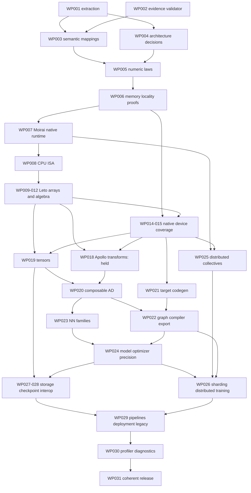

# Dependency-ordered implementation program

Program 2026-10-26.5. [Machine-readable packages](work-packages.json).

## Immediate sequence and readiness

1. **WP-002:** the first traceability/evidence validator and bounded source
   dispositions are integrated through #570/#571. Extend the executable gate
   to publicness, source-view conservation, reusable contracts and unresolved
   ownership. Honest incompleteness remains valid input and fails qualification.
2. **WP-001:** close extraction against exact release public documentation,
   generated exports and linked companion tools; resolve every named parser,
   patch-version, autodoc, guide/prose and namespace gap. Validate source
   hashes/counts and independently reconcile the denominator.
3. **WP-003 + WP-004:** assign every retained API to reviewed functional
   variants, materialize dtype/device/layout/gradient/domain classes and
   apply the [resolved scope policies](decisions.md) and complete required
   provider design reviews. Reconcile stale source
   checklists without granting unrun execution credit.
4. Implement provider-first WP-005 onward only when the specific slice's
   readiness contract is met. Existing repair owners retain their claims.

A work package marked `envelope` is a capacity/risk allowance, not a ready
implementation ticket. Before execution, its owner selects a finite set of
reference identities/coverage classes, records exact entry revisions and
test/benchmark commands, proves the prerequisite contracts, identifies actual
hardware and oracle packages, obtains applicable ADR sign-off, and decomposes
it into reviewable slices of at most one engineer-week. One owner is accountable
for each capability; cooperating owners implement only their existing provider
boundaries. Source prerequisites and exact consumer graph must be checked in
addition to this conceptual DAG.

## DAG and critical path

The machine package DAG includes RNG/device-RNG and iterative-solver branches
omitted from this readable figure. They are mandatory, not optional. The
longest planning-allowance path runs through definition, numeric/memory/runtime,
host algebra, device coverage, tensors/AD, graph compilation, model/training,
interop/deployment and final qualification. Apollo's service hold and hardware
availability can dominate elapsed time independently of engineering effort.
No elapsed-date commitment exists before those dependencies are resolved.

## Estimates and confidence

The 31 packages carry **110.4–324 engineer-weeks of initial allowances**, not a
lower/upper bound on full parity. Most confidence levels are low: semantic
expansion, nonnumeric elements, compiler/control effects, all vendor backends,
distributed failure handling and companion deployment tools are not yet sized.
Those unknowns can exceed the allowances; summing them into a deadline would be
false precision. WP-001/003/004 have 7–18 engineer-weeks combined allowance for
definition/review; independent parallel research can overlap portions, not remove
the acceptance work. WP-002 has 0.4–1 engineer-week allowance for implemented
tooling plus validation/review, not framework implementation.

After M0, derive estimates from actual operations and coverage classes, measure
two completed slices per owner, replace each envelope with bounded tickets,
recompute resource-constrained critical path and record confidence/range changes.
Report engineer effort separately from elapsed hardware/review/registry waits.
Do not inherit earlier initial scope estimates as promised deadlines.

## Evidence-required milestones

| Milestone | Entry | Exit evidence |
| --- | --- | --- |
| M0: definition accepted | Four frozen releases; audited provider revisions; protected owners known | Complete source dispositions; all public identities and variants mapped with coverage classes and exact prerequisite revisions; scope policies resolved, required concrete designs/ADRs reviewed; calibrated bounded tickets; independent scope review. Currently blocked. |
| M1: providers qualified | M0 for selected slice; signed contracts; real hardware | Numeric/memory/runtime/ISA/array/algebra/RNG/transform/device acceptance, differential and qualified benchmarks at exact source revisions. Native-runtime and Apollo holds resolved by owners. |
| M2: program/model semantics | Qualified provider graph | Tensor, all AD/transform/compiler/NN/optimizer/model and precision variants; complete bindings; real export/restore consumer evidence. |
| M3: distributed/deploy/tooling | M2 and real multi-node/target hardware | Collectives/sharding/training/faults, storage/interop/data pipelines, deployment targets and profiler/debug tooling; no hidden fallback. |
| M4: release candidate/1.0 | All obligations implemented and qualified | Per-repository exits, exact-head reviews/CI/SemVer, zero skipped required tests, all performance budgets, released upstream receipts, fresh consumers, coherent Atlas gitlinks and post-integration reruns. Only then version/release under normal policy. |

## Cross-repository release gates

Release providers before dependents using the actual Cargo/package graph.
Current Atlas gitlinks are reproducibility inputs, not assertions of latest
provider defaults. `repositories.json` records gitlink baselines, and
`provider-evidence.json` records independently fetched defaults; consumers must
select one coherent exact revision cohort and record it in evidence.

Every release requires stable documented public contracts, classified changes
and migration notes, all required ADR approvals, exact-revision independent code
review, formatting/typecheck/Clippy and applicable unit/property/fuzz/Miri/Loom/
integration/differential/performance gates. A skipped or baseline-unbuildable
SemVer comparison is not a verdict. Recheck effective branch rules and actual
required-check execution on the final integrated head. Inspect workflows and
repository deployment settings before each consequential action. Documentation
deployment is authorized; app/service deployment, access/security/credential
changes, license allowlist weakening and arbitrary timeout extensions are not.
Verify registry receipts/artifact contents and fresh external consumers with no
local overrides before downstream publication; repeat after integration.

## Ownership handoffs and holds

| Target | Owner and required handoff |
| --- | --- |
| Moirai notification prerequisite delivery/coordinator | Task `01a159ec-7017-7725-a554-194472dc20dc`, turn `01a176ab-537b-71fe-aa02-d59f00de713d`: commit `d94d5ab6e765ca0bf9fa4a8e95cc0037ec4959da` pushed and hooks pass. Draft PR creation is denied by GitHub HTTP403; no CI/merge/publication. Do not retry through another route. Scoped 56 passes/91 exclusions and API 223 passes/30 skips do not close runtime acceptance. |
| Native Tokio migration implementation | Task `01a176ac-6a9e-77cc-a488-42908214f023` has clean local `cab5499fa4ec41064a4c191b55911a8dbc852b60`, tree `45e6500a8b1b98eb48a6b41dc05843131f77ee3e`, with three test/docs changes above independently reviewed `b50a96cf`. It stops at ADR0084/external gates with no commands running under the latest parent handoff. No duplicate implementation or integration403 retry. |
| Native migration independent review | Same reviewer task `01a1771f-4ace-75e4-a240-c800b7d7e02a` is assigned the new exact head; sign-off remains pending. Parent `b50a96cf` passed the recorded scoped source review, including both P2 repairs. Owner reports current 192 async/QUIC,26driver,34Miri and six zero-Tokio graphs, but these are not new independent clearance. Mac81unshaped pairs do not replace Linux108pairs per policy plus30shared-queue pairs. ADR/platform/all-feature/fresh security/registry gates remain open. |
| Differentiable gammaln/lgamma | Task `01a17793-e227-73cf-b347-6c85477ef010` owns Eunomia digamma → Leto CPU operation → Coeus autograd and both Python aliases, after its local ownership check. It holds the single heavy-build slot. GPU acceptance is separate and mandatory; no silent CPU fallback. Planning does not duplicate this implementation. |
| Kwavers typed errors/Miri | Task `01a16141-84fd-7045-a5d6-75c04aafa0ef`: exact revision and real executed value/error/Miri evidence. |
| Apollo implementation | Task `01a13842-5a71-712c-b982-d6631f84e002`: service hold must be cleared through its existing owner before implementation retry. No bypass or replacement task. |
| Atlas #551 / Apollo #696 | Existing owners retain branches. Read-only audit links preserve exact failure evidence. Integration waits for version/license/registry closure through those owners. |
| Atlas full-parity program | This lane: denominator, semantic contracts, program, evidence gate and draft PR. No package version changes or provider repair mutation. |

## Current deployment inspection

Read-only GitHub inspection on October 26 finds Atlas `has_pages=false` and
`GET /pages` returns 404; the only repository environment is `copilot`, with
no deployment branch policy. Recent deployment listing is empty. PR checks run
on all pull requests; Python fast CI explicitly skips draft PRs. Book/crate
publication workflows are reusable callers. This planning branch changes no
publication caller, registry credentials, environment or deployment settings.
Required main status rules currently name workflow lint and the debt ratchet;
the new program additionally requires independent review even though the
observed rule set has no required-approval rule. Reinspect on any later merge.
